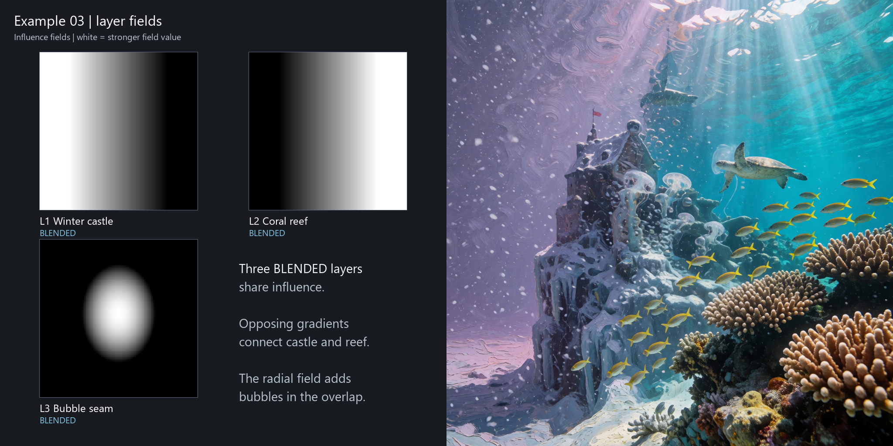
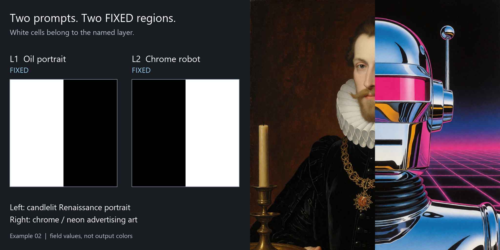
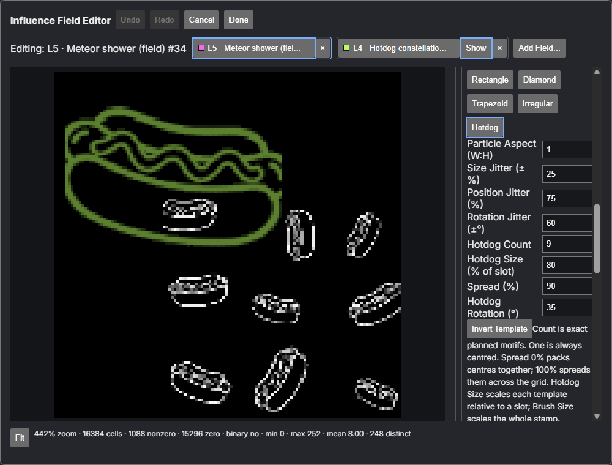

# Conditioning Layers

Conditioning Layers brings **regional prompting** to ComfyUI: give multiple prompt-conditioning regions their own editable grayscale **Influence Fields**. Built on ComfyUI masked conditioning, it adds **FIXED** exclusive ownership, **BLENDED** normalized spatial sharing, and deterministic composition of procedural, transformed and painted fields. This experimental alpha supports **Krea 2 in ComfyUI** and prompt conditioning only.



*Overlapping BLENDED fields place the violet impasto snow castle and photographic coral reef, controlling where their prompts share influence through the transition.* [Example 03](examples/conditioning-layers/03_blended_gradients.json).

**Recommended for new projects: the node-based Conditioning Layers workflow.** Start with [Example 01](examples/conditioning-layers/01_one_influence_field.json), then build toward more complex compositions.

[Install](#installation) · [Build a workflow](#build-your-first-workflow) · [Node guide](#node-guide) · [Painted Field](#painted-field) · [Examples 01–09](#examples) · [Contributing](docs/developer.md)

## What can you do with it?

- Assign different prompts and visual styles to separate FIXED regions: an oil-painted Renaissance aristocrat on the left, chrome robot advertising art on the right. Start with [Example 02](examples/conditioning-layers/02_two_fixed_regions.json).
- Transition from a snowy castle to a coral reef with overlapping BLENDED gradients. Try [Example 03](examples/conditioning-layers/03_blended_gradients.json).
- Paint where a glowing-armor prompt influences a character, using a reference image to place the field. Learn the editor with [Example 06a](examples/conditioning-layers/06a_painted_field_start.json) and its [completed version](examples/conditioning-layers/06b_painted_field_completed.json). **This controls conditioning during generation; it does not preserve an existing input image the way an inpainting workflow does.** The reference underlay is only a placement guide.
- Build geometric and patterned regions, then transform, repeat, blur, fade, remap or invert their fields. Explore [Example 04](examples/conditioning-layers/04_transform_repeat_fade_remap.json) and [Example 05](examples/conditioning-layers/05_patterns_and_templates.json).
- Import PNG brush tips, paint procedural Scatter or Noise, and explore deterministic Hotdog templates with [Example 07](examples/conditioning-layers/07_advanced_brushes.json). The motif shapes influence; it does not force the model to depict a hotdog.
- Edit several Painted Fields together and copy field content with [Example 08](examples/conditioning-layers/08_multi_field_painting.json). **Transfer** and **Balance** are also available editor tools; the saved example does not demonstrate those operations.
- Combine a photoreal alien market, an oil-painted traveler, watercolor twilight, charcoal smoke and neon graphics with [Example 09](examples/conditioning-layers/09_nine_layer_showcase.json). These are prompt ideas, not additional layer types.

These are creative possibilities, not promises of pixel-perfect localization or linear visual mixing. Prompts can still interact, and seams or semantic leakage can occur. The figures shown here are selected results from Examples 02 and 03; the other examples are editable workflows, not a gallery of verified generated results.

## Installation

Use an existing ComfyUI installation and its own Python environment. **Python 3.10 or newer is required by the source**; see [compatibility](#compatibility) and the [tested environments](docs/developer.md#environments). Models are installed separately below.

**Git installation** — from the directory containing your ComfyUI folder:

```sh
cd ComfyUI/custom_nodes
git clone https://github.com/SurrealByDesign/conditioning-layers.git
```

**ZIP installation** — on the [repository page](https://github.com/SurrealByDesign/conditioning-layers), choose **Code → Download ZIP**. Extract it into `ComfyUI/custom_nodes/` and rename the extracted folder to **`conditioning-layers`**. The loader must be at `ComfyUI/custom_nodes/conditioning-layers/__init__.py`, with no extra nested package folder. Keep the complete package together.

There is no separate pip package or frontend build step. ComfyUI supplies runtime dependencies such as Torch and aiohttp; do not install contributor test requirements into your working host as an installation step.

Restart ComfyUI and reload the browser. Search for **Conditioning Layer** and **Painted Field**. Confirm **Edit Field…** opens the editor before re-saving a painted example; saving without its custom widget can lose stored field data.

Workflows are in **`custom_nodes/conditioning-layers/examples/conditioning-layers/`** inside ComfyUI. Drag [Example 01](examples/conditioning-layers/01_one_influence_field.json) onto the graph canvas or use workflow **Open**. Select your local files in all three model loaders; keep **Load CLIP → type = `krea2`**.

Models are separate downloads and are not bundled. Krea publishes [Krea 2 Turbo](https://huggingface.co/krea/Krea-2-Turbo); the Comfy team provides [ComfyUI-ready files](https://huggingface.co/Comfy-Org/Krea-2). Open each file page below and choose **Download**, then place it in the listed folder. Follow the publishers' model terms; the extension's Apache-2.0 license does not replace them. The documented Turbo setup uses:

| Asset | ComfyUI model directory |
| --- | --- |
| [`krea2_turbo_bf16.safetensors`](https://huggingface.co/Comfy-Org/Krea-2/blob/main/diffusion_models/krea2_turbo_bf16.safetensors) | `models/diffusion_models/` |
| [`qwen3vl_4b_fp8_scaled.safetensors`](https://huggingface.co/Comfy-Org/Krea-2/blob/main/text_encoders/qwen3vl_4b_fp8_scaled.safetensors) | `models/text_encoders/` |
| [`qwen_image_vae.safetensors`](https://huggingface.co/Comfy-Org/Krea-2/blob/main/vae/qwen_image_vae.safetensors) | `models/vae/` |

The examples use separate model/text-encoder/VAE loaders, not a combined checkpoint loader. `SELECT_...` values are **placeholders for your local files**, not missing bundled downloads; three loader warnings are expected until you select assets. The Turbo examples use eight steps, CFG 1, Euler/simple and an empty negative prompt.

### Update and uninstall

To **update**, back up workflows, exported fields and ComfyUI user data, then stop ComfyUI. For a Git installation:

```sh
cd ComfyUI/custom_nodes/conditioning-layers
git pull
```

For a ZIP installation, download a fresh ZIP and replace the package folder with its complete contents. Restart ComfyUI, refresh the browser, and check **Edit Field…** before re-saving painted workflows. This updates the extension; it does not update ComfyUI.

To **uninstall**, stop ComfyUI, remove `custom_nodes/conditioning-layers/`, then restart and refresh. Workflows that use its nodes will show missing nodes. Keep workflow backups and any exported PNGs. The Brush Library and sidebar documents live in ComfyUI user data separately from this package; removing the package does not remove them.

## Build your first workflow

An **Influence Field** is a **128 × 128, 8-bit ComfyUI MASK** used to control spatial participation of a **Conditioning Layer**. Its 0–255 values travel as a float32 MASK with exactly recoverable 8-bit values.

- **Black:** no influence (0).
- **Gray:** partial field value (1–254).
- **White:** maximum field value (255).

Gray values matter as **relative weights where two or more BLENDED Conditioning Layers overlap**. A BLENDED Conditioning Layer with positive Strength that is alone at a location receives full normalized weight wherever its field is above black and no FIXED Conditioning Layer owns the cell. An enabled FIXED Conditioning Layer owns every positive cell in its region, including gray cells. **A lone gray gradient does not automatically fade a prompt into nothing.**

A field controls participation; it does not paint output colors. A brush changes the field, and the prompt supplies the concept. The saved-document model calls this prompt-only type a **Prompt Layer**; this guide uses **Conditioning Layer**, matching the node name.

Start with Example 01 and its normal Krea 2 loader/sampler connections.

1. Add **CLIP Text Encode** for your regional prompt and connect the Krea 2 CLIP output to it.
2. Add a field source, such as **Rectangle Field**, and a **Conditioning Layer**. Connect the field's `MASK` output to `mask` and the prompt's `CONDITIONING` output to `conditioning`.
3. Set **Strength** from **0–1** (default **1**), choose **FIXED** or **BLENDED** (new nodes default to **BLENDED**), and leave `enabled` on. Example 01 uses a FIXED astronaut region and a BLENDED Solid background.
4. Add **one Add Conditioning Layer node per Conditioning Layer**. Connect `layer` to `layer`. Leave the first Add node's optional `layers` input empty; connect each subsequent Add node's `layers` input to the preceding Add node's stack output.
5. Connect the final stack to **Compose Conditioning Layers**, and its `CONDITIONING` output to the sampler's positive input. Keep the usual model, latent, negative, VAE and output connections shown in Example 01.
6. For a second Conditioning Layer, repeat steps 1–4 with its own prompt and field. Use disjoint FIXED rectangles for Example 02, overlapping BLENDED gradients for Example 03, or **Painted Field → Edit Field… → Done** for painted regions.

```text
Prompt A + Field A -> Conditioning Layer A -> Add A --layers--> Add B -> Compose -> sampler positive
Prompt B + Field B -> Conditioning Layer B --------------------layer--^
```

The `mask` input accepts **MASK data** with exact 128 × 128, 8-bit values. You can load an unresized **128 × 128, 8-bit grayscale PNG** with **Load Image (as Mask)**, selecting **red** (or green/blue for the same grayscale values), rather than the alpha channel. Arbitrary resized or processed masks may fail validation. Use the supplied field processors or the editor's explicit **Import Mask…** operation to produce valid fields. An enabled Conditioning Layer must have some positive field values; disable an empty one instead.

The field grid spans the full output frame. On a non-square output, ComfyUI maps the square mask across the latent width and height without preserving the field's square aspect: a circle can map to an ellipse. Keep the field at 128 × 128 before Compose; ComfyUI performs any downstream mask scaling. The shipped examples use 1024 × 1024; non-square generated results are not established by these examples.

**Example 01 coverage:** a FIXED Ellipse Field (center 44, 72; radii 16 and 36 cells) gives the red astronaut its region. A full-frame Solid Field at value 255 feeds a BLENDED snowfield background. Both have Strength 1; the background fills every cell outside the FIXED ellipse. This is the [background prompt](#background-prompt) recipe in a complete workflow.

## How it fits together

```text
Prompt -> CLIP Text Encode -----+
                               v
Influence Field ----------> Conditioning Layer
  optional field processing    |
                               v
                      Add Conditioning Layer -> ... -> Compose Conditioning Layers
                                                               |
                                                               v
                                                       KSampler positive
```

Encode a prompt, create a field, and connect both to **Conditioning Layer**. Chain one **Add Conditioning Layer** node per Conditioning Layer, then use **Compose Conditioning Layers** to produce conditioning for the sampler. Model loading, latent creation, negative conditioning, sampling, VAE decoding and image saving remain ordinary ComfyUI operations.

## FIXED and BLENDED Conditioning Layers

**FIXED means spatial ownership.** Every positive cell in an enabled FIXED field belongs to that Conditioning Layer. Two enabled FIXED regions cannot overlap, even if one has Strength zero. Soft gray edges still claim ownership; they do not feather a FIXED boundary.



*One generated composition, not a collage: complementary FIXED fields assign the candlelit Renaissance portrait to the left and chrome neon advertising art to the right.* [Example 02](examples/conditioning-layers/02_two_fixed_regions.json).

**BLENDED means normalized sharing.** Fields may overlap; their participating influences normalize against one another. Use opposing gradients to transition between two prompts. Strength changes relative weight where contributors overlap. One positive contributor receives the whole local share.

You may mix the two modes: FIXED ownership is resolved first, and BLENDED Conditioning Layers share the remaining locations. A zero-Strength FIXED owner still reserves its region but contributes nothing there. Stack order does not provide a tie-break or visual priority. Disable a Conditioning Layer to remove its participation.

Participating BLENDED Conditioning Layers use `u = field × Strength`, then `weight = u / sum(u)` wherever the sum is positive. Where nothing participates, there is **no hidden base prompt fill**; this does not promise blank pixels or preservation of an input image.

### Background prompt

For subject regions on FIXED Conditioning Layers, add a full-frame **Solid Field** (value 255) as a **BLENDED background Conditioning Layer** with positive Strength. It fills cells no FIXED Conditioning Layer owns.

If the background Solid overlaps BLENDED Conditioning Layers, its **Strength participates in normalization**. Lower its Strength if you want the other BLENDED Conditioning Layers to dominate. Stack position does not make it a background; the field and mode do.

Example prompts may repeat scene/context text so each regional prompt carries that context. There is **no hidden node-system Base Prompt automatically filling uncovered regions**. Add the background explicitly when you want full-frame support.

### How it works for technical users

**Compose Conditioning Layers outputs ordinary ComfyUI masked conditioning entries**, one per enabled Conditioning Layer. Each gets its own normalized weight mask, with FIXED ownership resolved first. The original prompt tensors are preserved; Compose sets `mask_strength` to 1 and `set_area_to_bounds` to false. It builds on ComfyUI conditioning and does not replace the sampler.

**Compose requires float32 (binary32) intermediate execution.** Start ComfyUI without `--fp16-intermediates`; this restriction applies to Compose as well as the legacy optional helper.

Each Conditioning Layer accepts one prompt encode (one conditioning entry, batch size 1). Upstream masks, areas, timestep ranges, GLIGEN and hooks are rejected. **ControlNet-modified conditioning is unsupported at the Conditioning Layer input.** No end-to-end ControlNet compatibility is claimed for other graph arrangements.

## Node guide

The names below are the runtime display names. Search for them in ComfyUI; QR and UPC are choices within **Preset Field**, not separate nodes.

### Assemble Conditioning Layers

| Node | Purpose and common use | Try it |
| --- | --- | --- |
| **Conditioning Layer** | Pairs conditioning with a field, Strength, FIXED/BLENDED mode and enabled state. | Give two Conditioning Layers distinct regional prompts. |
| **Add Conditioning Layer** | Starts an ordered stack or appends one Conditioning Layer to it. | Add a sky or foreground Conditioning Layer. |
| **Compose Conditioning Layers** | Validates enabled Conditioning Layers and resolves their spatial weights into sampler conditioning. | Use BLENDED gradients with overlapping companions to explore sharing. |

### Create fields

| Node | Purpose and common use | Try it |
| --- | --- | --- |
| **Solid Field** | Makes a constant field, useful for full-frame BLENDED support. | Add a broad atmosphere prompt sharing space with regional BLENDED fields. |
| **Rectangle Field** | Defines a rectangular region for panels, horizons or graphic layouts. | Split the frame into nonoverlapping left/right FIXED regions. |
| **Ellipse Field** | Defines an elliptical region for subjects and circular details. | Place an oval over a portrait subject. |
| **Linear Gradient Field** | Changes influence along a direction for transitions. | Pair opposing gradients with two BLENDED prompts. |
| **Radial Gradient Field** | Varies field values around a center for relative BLENDED weighting. | Share a central concept with an overlapping BLENDED background. |
| **Pattern Field** | Loads one of the shipped patterns and inverse variants. | Explore checkerboard, rings, stripes or scattered islands. |
| **Scatter Field** | Generates seeded scattered shapes across the field. | Make repeated islands of a contrasting prompt. |
| **Noise Field** | Generates deterministic noise-based influence. | Build irregular smoke or weather regions with BLENDED layers. |
| **Cyclic Partition Field** | Produces members of a repeating spatial partition. | Connect different member outputs to different regional prompts. |
| **Voronoi Partition Field** | Produces seeded nearest-site partition regions. | Make an irregular mosaic of concepts. |
| **Polar Partition Field** | Produces partition regions arranged around a center. | Build a radial composition from matching partition members. |
| **Preset Field** | Loads checksum-verified binary QR or UPC fields with dark/light variants. | Use QR structure or barcode stripes to organize a graphic prompt. Generated images are not guaranteed scannable codes. |
| **Painted Field** | Stores a field painted or imported in the node-launched editor. | Trace selected armor plates over a reference underlay. |

The **Cyclic, Voronoi and Polar Partition Field** nodes each expose four outputs: `field_a`, `field_b`, `field_c`, `field_d`. Only the first `members` outputs participate; outputs beyond that count are empty (all black). Some participating members can also be empty for a particular geometry. Omit or disable empty Conditioning Layer branches.

### Process fields

These nodes process the field before it reaches a Conditioning Layer. They do not apply image effects to generated pixels.

| Node | Purpose and common use | Try it |
| --- | --- | --- |
| **Field Transform** | Moves, scales and rotates a field. | Rotate an ellipse into a diagonal subject region. |
| **Field Repeat** | Repeats an existing field across X and Y for windows, tiles, signs or stripes. | Connect Rectangle Field or Pattern Field and increase Repeat X/Y. |
| **Field Remap** | Remaps field values to change relative BLENDED weights or positive support. | Tighten a gray transition before BLENDED composition. |
| **Field Blur** | Smooths field values spatially; it can extend positive support. | Smooth relative sharing between overlapping BLENDED Conditioning Layers. |
| **Field Fade** | Reduces field values spatially. | Reduce repeated motifs' relative weight toward an edge where another BLENDED Conditioning Layer overlaps. |
| **Invert Field** | Exchanges low and high influence. | Derive an opposing gradient from the first field. |

### Legacy / optional node

**Normalized Blend Preparation** is a lower-level helper for exactly three conditioning entries. It registers only when **Torch 2.8.0+cu129, NumPy 2.4.6 and PyAV 17.0.1** match exactly, `--fp16-intermediates` is absent, and its source-integrity check passes. Execution also requires float32 intermediates.

Its absence is normal on most installations and it is **not required for normal Conditioning Layers usage**. **22 nodes versus 23 is not, by itself, a broken installation**: the extra node is this optional helper. Use **Conditioning Layer → Add Conditioning Layer → Compose Conditioning Layers** for normal workflows.

## Painted Field

Click **Edit Field…** on a Painted Field node, double-click its thumbnail, or right-click the node and choose **Edit Influence Field…**. The editor changes the field's grayscale values. It does not read your prompts, choose layer modes or generate an image.

Start with **Paint**, **Erase**, **Size**, **Influence** and **Hardness**. **Amount (%)** is under **Advanced → Brush Behavior**:

- **Paint** moves covered cells toward the chosen Influence value. **Erase** moves them toward black. **Restore**, in Advanced Brush Behavior, paints toward the field as it was when it joined the session.
- **Size** controls the footprint in field cells. **Influence** is the target value, shown as a percentage or an exact 0–255 value. **Amount** limits how far a stroke moves toward its target. **Hardness** controls the full-coverage portion of the footprint and its soft edge.
- Use **Undo/Redo** to revise local edits. **Done** commits fields and settings back to the nodes; **Cancel** discards this session's changes. After **Done** changes field pixels, ComfyUI graph **Undo** can reverse that committed transaction, including a multi-field save. Save the ComfyUI workflow afterward to keep the committed fields.

Open **Advanced → Field Tools** for rectangle and ellipse selections that constrain edits; combine, invert or clear selections to isolate a region. Clear/Fill/Invert act within the selection when one is active. Field Tools also provide exact flips and quarter-turn rotations; clear the selection before those whole-field transforms. Use the Field Transform node for adjustable offsets, scaling and other angles.

A **reference image** is a display-only guide. Grid and **Heat View** help inspect cell boundaries and low influence; **Alt-click** samples a field value with the eyedropper. These views do not become conditioning or modify the saved field.

**Import PNG** reads an exact 128 × 128 grayscale field. **Advanced > Field Tools > Import Mask…** accepts supported PNG masks at other sizes, shows an explicit preview, and reduces/enlarges them to the field grid with deterministic area averaging. Choose Graded or Binary output and review before Apply. Import Mask creates one undo step and respects the active selection. **Export PNG** saves the field for reuse.



*Painted Field editor: edit one field while viewing a companion overlay; brush controls shape the grayscale influence.*

### Where to find controls

| Control | Location |
| --- | --- |
| Amount (%) | **Advanced → Brush Behavior** |
| Rectangle/ellipse selections and Import Mask… | **Advanced → Field Tools** |
| Custom Tip | **Advanced → Brush Shape & Transform → Shape: Custom → Custom Tip → Import Tip PNG…** |
| Procedural tips | **Advanced → Brush Shape & Transform → Shape: Procedural → Procedural Tip**; choose **Type: Scatter** or **Noise** |
| Hotdog template | In **Procedural Tip**, choose **Type: Scatter → Particle Shape: Hotdog** |
| Reference image | **Advanced → Load Reference Image…** |
| Pen pressure | **Advanced → Brush Behavior → Pen Pressure → Use Pen Pressure** |

### Paint against a reference

1. Queue once with a fixed sampler seed and save the result.
2. Open Painted Field and use **Advanced → Load Reference Image…** to load that result.
3. Paint the intended regions over the reference, then press **Done**.
4. Queue again using the same model, settings and fixed seed.

This is **regeneration with spatial conditioning, not inpainting**; changes can extend outside the painted regions. The reference is display-only and **session-only**: it is not saved with the workflow and must be loaded again after reopening the editor.

### Shortcuts

These shortcuts apply while the editor is active and you are not typing in a numeric control or using a subdialog.

| Shortcut / gesture | Action |
| --- | --- |
| **B / E** | Paint / Erase |
| **Ctrl/Cmd+Z** | Undo |
| **Ctrl/Cmd+Shift+Z** or **Ctrl/Cmd+Y** | Redo |
| **[ / ]** | Decrease / increase brush Size by 1 |
| **Shift+[ / Shift+]** | Decrease / increase Hardness by 1 |
| **1–9, 0** | Influence 10–90%, then 100% |
| **F** | Fit the field in the view |
| **Hold Space + drag** | Pan; when the Compare button is focused, Space instead reveals the reference |
| **Esc** | Cancel, with discard confirmation if changed; during a stroke/selection gesture, abort that gesture first |
| **Alt-click** | Eyedropper: sample the field value (turn off the selection tool first) |
| **Drag PNG onto the canvas** | Import an exact 128 × 128 grayscale field; use Import Mask… for other supported PNG sizes |

### Brushes

#### Basic brush shapes

Disk, Square and Diamond define the footprint. **Advanced > Brush Shape & Transform** lets you scale and rotate it; falloff shapes its edge.

#### Brush behavior

Spacing controls stamps along the stroke. **Build-up** enables distance-based accumulation, with **Flow** controlling its rate, capped by Amount. **Raise Only** and **Lower Only** constrain ordinary edits to one direction. Uniform, Linear Gradient, Radial Gradient and Square Gradient value profiles control the values painted within the footprint.

#### Custom Tip

Import a local PNG. Choose **Alpha**, **Luminance** or **Alpha × Luminance** to determine coverage, and use crop/trim, scale, mirror and rotation controls to place it. The tip shapes where influence is painted; its colors do not become output colors. The accepted tip data can travel with saved settings and brush presets, without depending on the original local filename.

#### Procedural brushes

Scatter and Noise produce reusable deterministic tips. Scatter offers built-in Circle, Rectangle, Diamond, Trapezoid and Irregular shapes, plus Hotdog. Adjust the seed and the applicable density, size and jitter controls to explore variants.

#### Hotdog Template

This built-in deterministic motif/scatter example demonstrates template-backed brushes. Set **Count from 1-1024**, then adjust Size, Spread, Rotation, Rotation Jitter, Mirror and Invert. **Count = 1** behaves like a single motif brush; larger counts create a deterministic scatter. The same seed and settings reproduce the same template layout. Spread changes placement rather than count; brush Size scales the overall footprint. A motif remains an influence structure, not an inserted picture.

#### Brush Library

Save reusable brush configurations and **Apply**, **Update**, **Rename**, **Duplicate** or **Delete** them. Use favorites, categories and search to find a preset. The library is available across workflows/editor sessions in the same ComfyUI user setup; **Export Preset JSON** exports the selected preset only; **Import Preset JSON…** imports one preset. Repeat for other presets to share configurations. Opening an example does not install its presets automatically.

The library is stored in the active ComfyUI user's data as `conditioning-layers/brush-library-v1.json` (normally `ComfyUI/user/default/conditioning-layers/brush-library-v1.json` for the default user). A custom user directory or multi-user setup changes the prefix. Back up that file for the complete library, or export individual presets through the editor. It is separate from workflow state.

Presets store brush configuration, not field content, selections, history or field relationships. **Transfer/Balance partner identity and Active Share are not stored.** Applying a preset does not select a partner or change the active cross-field tool.

#### Pressure

When enabled, pen pressure can affect **Size**, **Amount** and **Flow**; Flow pressure applies with Build-up. Choose the mappings you want. A physical pen is optional: mouse, touch and Shift-click lines use the set values. Some pressure tests used synthetic pen events, so physical-device behavior should be checked on your own tablet/browser combination.

### Multi-field editing

Open one Painted Field, then use **Add Field** to bring in other Painted Field nodes from the same workflow. A session holds **up to four fields**. Exactly one is active and editable; the others appear as overlays. Select a field to make it active.

Each field keeps its own brush settings, selection, Restore baseline and local history as you switch. **Copy From** replaces active-field cells with another participant's current values, respecting the active selection and leaving the source unchanged. **Done** commits the participating changes together; **Cancel** discards them together. Use **×** on a field tab to remove it from a multi-field session; this leaves its node in the graph and discards its uncommitted session changes after confirmation. The last remaining field cannot be removed. Reopening starts a new session: add companion fields again as needed.

### Transfer

Transfer moves influence **from another participating field into the active field**. The active field is the destination. In **Advanced > Brush Behavior**, choose **Transfer from** the source field, then paint.

At each changed cell, what the destination gains, the source loses. Their **local pair total is conserved**:

```text
Source 200 + Destination 40 = 240
                  move 30
Source 170 + Destination 70 = 240
```

Brush coverage determines where transfer occurs; Amount controls movement toward the available limit. Transfer works with Custom Tip, Procedural and Hotdog brushes, selections and pressure. It cannot drain below zero or fill above 255. The active field's selection gates both changes. Influence targets, gradient value profiles and Raise/Lower do not apply to this tool.

Paired Undo/Redo keeps both fields synchronized. If a partner has a later edit, the editor tells you which field to undo first rather than undoing only half the transfer.

Transfer is useful for moving a boundary or exchanging influence without adding to the pair's local total. Its **source/destination pairing is session-only**: after reopening, add the companion field and choose the source again.

### Balance

Balance paints two fields **toward a chosen ratio**. Choose **Balance with** one partner, then set **Active Share (%) from 0-100**. A stroke can move influence in either direction automatically, with the same conserved local pair total.

```text
Active A = 20, Partner B = 180; total = 200
Active Share = 75% -> target 75:25 -> A = 150, B = 50
```

That is the target split: brush coverage and Amount determine how far a stroke moves toward it. Whole-number values and the 0-255 limit may restrict the exact split when the total is large. **100% corresponds to Transfer from the partner; 0% moves in the reverse direction.** Balance uses one active field and one partner, with paired Undo/Redo. It does not normalize all fields or inspect FIXED/BLENDED composition.

Balance is useful when you want a consistent relative split, such as more atmosphere and less subject influence, without changing the pair's local total. **The partner and Active Share are session-only**. Reopening starts with no partner and Active Share **50%**; select the tool and partner again.

For **two enabled BLENDED Conditioning Layers with equal Strength**, conserving their local field total keeps their combined unnormalized weight unchanged. At cells not owned by FIXED, a third unchanged overlapping BLENDED Conditioning Layer therefore keeps its normalized share, provided all other inputs stay unchanged. This follows from `field × Strength` normalization on the field grid; it is not a promise that generated pixels stay unchanged. Different Strengths, later field processing or FIXED ownership can invalidate that reasoning. The editor itself does not inspect modes or Strength.

## Examples

The [Conditioning Layers Examples](examples/conditioning-layers/README.md) are the official example set. **Start with 01, then 02 and 03; use 06a/06b to learn painting.** Open their JSON files manually in ComfyUI; nested examples are not promised to appear automatically in a template gallery.

| Sequence | Scene and feature |
| --- | --- |
| [01 - One Influence Field](examples/conditioning-layers/01_one_influence_field.json) | Red astronaut in snow: FIXED ellipse plus BLENDED Solid background. |
| [02 - Two Fixed Regions](examples/conditioning-layers/02_two_fixed_regions.json) | Renaissance portrait versus chrome robot advert: disjoint left/right ownership. |
| [03 - Blended Gradients](examples/conditioning-layers/03_blended_gradients.json) | Snowy castle into coral reef: opposing gradients and a radial bubble seam. |
| [04 - Field Processing](examples/conditioning-layers/04_transform_repeat_fade_remap.json) | Neon megablock: Rectangle through Repeat, Transform, Fade, Remap and Blur. |
| [05 - Patterns and Templates](examples/conditioning-layers/05_patterns_and_templates.json) | Retro diner collage: complementary patterns, QR/UPC presets and Hotdog line art. |
| [06a - Painted Field Start](examples/conditioning-layers/06a_painted_field_start.json) / [06b - Completed](examples/conditioning-layers/06b_painted_field_completed.json) | Rune-lit knight: starter and completed local glow fields. |
| [07 - Advanced Brushes](examples/conditioning-layers/07_advanced_brushes.json) | Hotdog nebula: Custom Tip, procedural Noise and single/scattered/inverted Hotdogs. |
| [08 - Multi-Field Painting](examples/conditioning-layers/08_multi_field_painting.json) | Tin-toy robot: four coordinated fields, tabs, overlays and Copy from. |
| [09 - Nine-Layer Showcase](examples/conditioning-layers/09_nine_layer_showcase.json) | Alien night market: distinct regional styles using the major tools together. |

Import [Hotdog meteor shower](examples/conditioning-layers/presets/hotdog_meteor_shower.brush.json) and [Sparkle glints](examples/conditioning-layers/presets/sparkle_glints.brush.json) through Brush Library for the brushes used in 07. All examples provide full field coverage. The pack contains instructions and embedded fields/tips, not verified generated outputs. Nine layers is a demonstration, not a maximum or a resource guarantee.

## Legacy sidebar

Conditioning Layers also adds a tab in ComfyUI's left sidebar for the older **`.conditioning.json` document-oriented workflow**, with Open, Save, Save As and a Base Prompt. **Use node workflows for new projects; node-only users can generally ignore this tab.** The two saved formats do not automatically convert into one another.

Sidebar generation supports **1–3 Active Conditioning Layers with No Overlap**, or **exactly 3 with document-level Blend**. It targets the specific **ComfyUI 0.34.6 / frontend 1.49.6 Krea 2 Turbo BF16 setup on port 8000**, with additional model checks. Newer node/editor compatibility does not imply sidebar generation support. See [sidebar compatibility](docs/developer.md#sidebar-compatibility).

## Compatibility

| Tier | ComfyUI | Frontend | Evidence |
| --- | --- | --- | --- |
| Qualified baseline | 0.34.6 | 1.49.6 | Established baseline testing. |
| Successfully functional-smoke-tested | 0.39.2 | 1.53.10 | Core painting, brushes, multi-field editing, Transfer, Balance, Undo/Redo, save/reopen and example loading. |

The newer pair has narrower test coverage than the baseline. Other combinations are not established. These node/editor results do not widen sidebar generation support. See the [public validation summary](docs/developer.md#validation) for automated checks and their limits.

## Troubleshooting

| Symptom | Likely cause | Shortest fix |
| --- | --- | --- |
| FIXED regions overlap | Two enabled FIXED fields have positive cells in common, including gray edges. | Move/shrink the fields or use BLENDED sharing. Strength zero does not remove FIXED ownership; disable the layer if unwanted. |
| Field has no positive sample | An enabled field is entirely black, possibly an unused partition output. | Paint/add positive cells, connect a nonempty output, or disable the layer. |
| Mask shape/codebook rejected | Resizing or generic mask processing lost the exact 128 × 128, 8-bit field values. | Use the supplied field nodes or **Advanced → Field Tools → Import Mask…**. For an exact grayscale PNG, use **Load Image (as Mask) → red**, without resizing. |
| Compose requires binary32 intermediate execution | ComfyUI is using half-precision intermediates, such as `--fp16-intermediates`. | Remove that startup flag and restart; Compose requires float32 intermediates. |
| Unsupported conditioning metadata | Upstream conditioning contains ControlNet, area, timestep, mask or hook data. | Connect a plain prompt encode to each Conditioning Layer; these upstream modifiers are unsupported at its input. |
| Expected exactly one conditioning entry | Multiple prompt encodes were combined upstream. | Give each Conditioning Layer one prompt encode; combine layers through **Add Conditioning Layer → Compose**. |
| `IMPORT FAILED` or missing nodes | Incomplete/nested installation, missing host dependencies, or an import failure. | Check the ComfyUI console for the first error and **Conditioning Layers** warnings; verify the complete folder layout and restart. An optional Blend-helper warning alone does not disable normal nodes. |
| Missing **Edit Field…** button | The frontend adapter did not load or the browser has stale assets. | Restart ComfyUI and hard-refresh the browser; verify the complete `web/` folder. Do not re-save painted examples until the button works. |
| Sidebar **Generate** refuses to run | The older document workflow has stricter host, port, format and layer limits. | Use the recommended node workflow, or check the sidebar's message and [sidebar compatibility](docs/developer.md#sidebar-compatibility). |

## Current limits

- Krea 2 and prompt-based Conditioning Layers only; there is no claim of other-backend compatibility, separate Style/Control/LoRA layers or per-region MODEL-LoRA isolation.
- Native fields remain 128 × 128. Spatial influence is experimental; perceptual linearity and perfect isolation are not guaranteed.
- Multi-field sessions hold four Painted Fields maximum. Transfer and Balance are pairwise; N-field normalization/redistribution is not implemented in the editor.
- Connect one plain prompt encode per Conditioning Layer. ControlNet-modified conditioning and other upstream spatial/scheduling metadata are unsupported at that input; see [How it works](#how-it-works-for-technical-users).
- Models must be selected locally. Layer count can increase sampling cost; example 09 establishes no GPU-memory budget.
- Sidebar generation has separate document and host limits: 1–3 Active Conditioning Layers with No Overlap, or exactly 3 with document-level Blend. Larger native node compositions do not widen these limits.
- This alpha makes no stable public workflow-schema or migration promise. Keep backups of valuable workflows, especially before loading them without the extension installed.

## Development

Python lives in `src/conditioning_layers/`; the root `__init__.py` is the ComfyUI loader. Frontend modules live in `web/js/`, with editor logic in `web/js/field_editor/` and the host adapter in `web/js/painted_field_node.js`. Runtime field assets retain their existing library and `studies/STUDY-0001/reference-fields/` locations.

From the package root, use a configured developer Python environment and Node.js for the editor lane:

```text
python -X utf8 -B -W error tests/tooling/public_offline.py domain
python -X utf8 -B -W error tests/tooling/public_offline.py field-editor
python -X utf8 -B -W error tests/tooling/public_offline.py hotdog-template
node tests/tooling/validate_examples.mjs
```

Node/runtime and Python example validation use the separate host-dependency lane. See [developer instructions and all test groups](docs/developer.md), [architecture](docs/architecture.md) and [validation results](docs/developer.md#validation).

## License and contact

Copyright 2026 SurrealByDesign. Licensed under the [Apache License 2.0](LICENSE).

**SurrealByDesign** - surrealbydesign@protonmail.com
